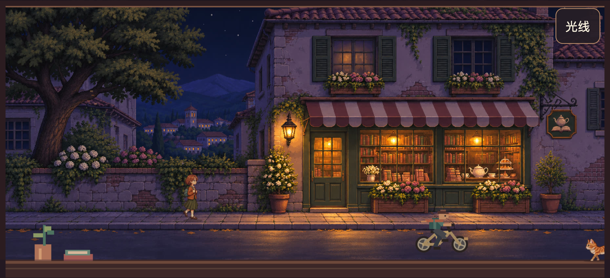

# 像素窗景 · Pixel Window

把一台闲置的 Android 手机变成横屏常亮的像素窗景。窗外是一条有茶书店、行人和骑车人的街道，橘猫偶尔会到窗台走一圈。

[前往 Releases 下载 APK](https://github.com/KeyOfTheQuestion/pixel-window-android/releases/latest)

[打开 iPhone 轻量版](https://keyofthequestion.github.io/pixel-window-android/iphone/)



## 安装和使用

1. 在 Android 11 或更新版本的设备上下载并打开 Releases 中的 APK。
2. 如果系统询问安装权限，按提示允许当前浏览器或文件管理器安装这个 APK。
3. 打开「像素窗景」，将手机横放。画面默认全屏常亮，长按可选择白天、夜晚或跟随北京日出日落。

街景和动画在手机上绘制，安装后可离线使用。自动光线以北京时间为准，在北京日出和日落附近逐渐变亮或变暗。

## iPhone 轻量版

用 Safari 打开上方链接，从分享菜单选「添加到主屏幕」。如果看到「作为网页 App 打开」，请开启它，然后点「添加」。横放手机即可看完整窗景。画面右上角的「光线」可以切换昼夜，在浏览器支持时也可开启保持亮屏。首次打开后，等设置中显示素材已缓存，即可离线打开。

轻量版源码在 `docs/iphone/`，使用 Canvas 和浏览器的离线缓存，可部署到任意 HTTPS 静态站点。

## 窗外有什么

- 三位访客会从街道两边走来。茶书店的单扇木门绕左侧铰链向内打开，门后的灯和书架固定在原位。访客进店后，可以透过窗户看到她们读书。
- 骑车人白天和夜晚都会经过，约每 28 秒来一趟，方向交替。
- 橘猫四爪交替踩过窗台，会在自行车靠近时避让，也会蜷起来休息。

## 从源码构建

构建脚本面向 macOS。准备 JDK 21、Android SDK Platform 34 和 Build-Tools 34.0.0，并在需要时用 `JAVA_HOME` 和 `ANDROID_HOME` 指定安装路径。

```bash
git clone https://github.com/KeyOfTheQuestion/pixel-window-android.git
cd pixel-window-android
./构建安卓.command
```

构建完成后，项目根目录会生成 `像素窗景.apk`。`PIXEL_WINDOW_APK` 可指定输出位置。脚本会为本地构建创建签名密钥，也可以通过 `PIXEL_WINDOW_SIGNING_KEY` 指定已配置的本地构建密钥。若要覆盖更新已安装的 GitHub 发行版，请下载同一仓库的新 APK。

## 素材与参考

茶书店昼夜底图、橘猫和读书人物为本项目生成的像素风素材，保存在 `android/res/drawable-nodpi/`。步态动画参考了真实的猫咪行走录像，光线按日照公式离线计算。[猫步录像与研究](https://journals.plos.org/plosone/article?id=10.1371/journal.pone.0003808#s4) · [NOAA 日照公式](https://gml.noaa.gov/grad/solcalc/solareqns.PDF)

项目使用 [MIT 许可证](LICENSE)。
